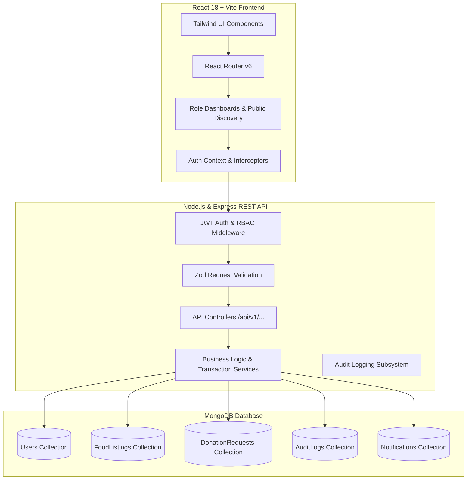
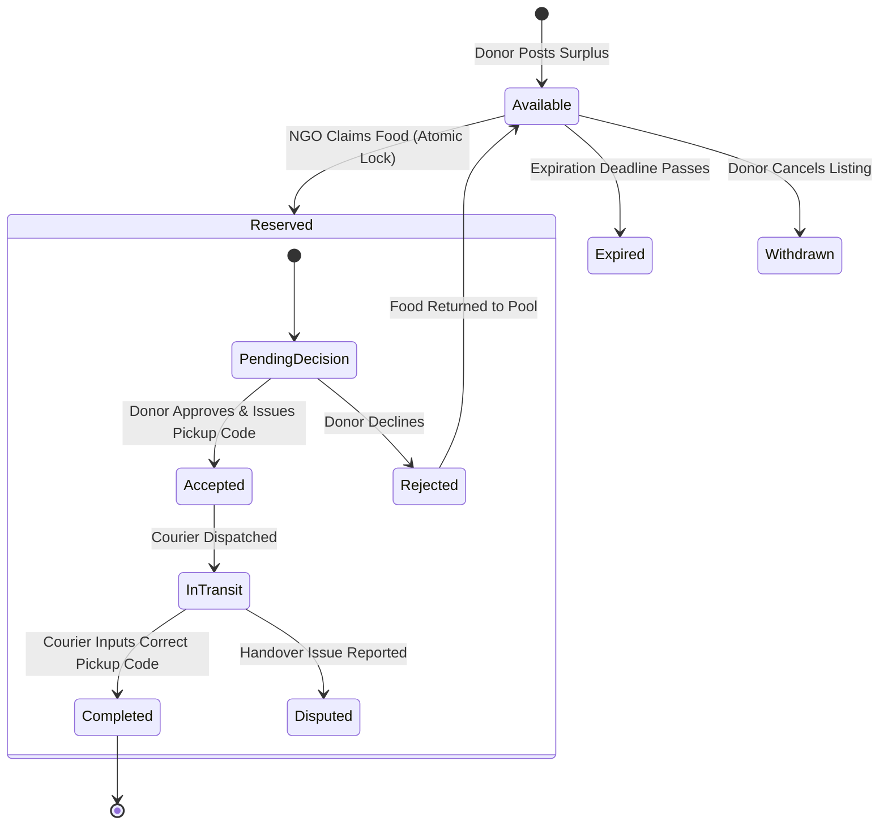

# FoodBridge 🍲🌱
> **Complete MERN Stack Surplus Food Redistribution Platform**  
> *Connecting restaurants, event caterers, and households with verified local shelters and food banks in real time.*

---

## 🌟 Overview & Key Highlights

FoodBridge is an end-to-end, production-grade web application engineered to eliminate urban food waste and address localized food insecurity. Built with a full **MERN stack (MongoDB, Express.js, React, Node.js)**, Tailwind CSS, Leaflet Maps, and MongoDB atomic transactions, FoodBridge solves the fundamental problems of donation double-claiming, perishable spoilage, and lack of accountability.

### 🛡️ Core Innovations
1. **Atomic Reservation Locking:** Uses MongoDB multi-document ACID transactions to ensure surplus items can never be double-claimed by competing NGOs.
2. **One-Time Handover Codes:** Handover of food requires a cryptographic 8-character hex pickup code generated on the donor's screen and confirmed by the courier upon physical receipt.
3. **Unit-Disaggregated Aggregation:** Prevents incorrect mathematical additions (e.g., adding kg to liters or meals). Analytics strictly group impact by unit.
4. **Role-Based Workflows:** Distinct interfaces for Donors, NGOs/Shelters, Volunteer Couriers, and Platform Administrators.
5. **Strict Verification Workflow:** NGOs and businesses provide legal registration/tax identification for platform approval before claiming privileges are unlocked.

---

## 🏗️ System Architecture



---

## 🔄 Food Donation & Handover Lifecycle



---

## 🔑 Demo Accounts (Pre-Seeded)

All demo accounts use the standard password: `Demo@1234`

| Role | Email | Name / Organization | Description |
|---|---|---|---|
| **Platform Admin** | `admin@demo.local` | Platform Administrator | Full system moderation, verifications, and audit log access |
| **Organization Donor** | `donor.greenbistro@demo.local` | Green Bistro Restaurant | Verified commercial restaurant posting cooked surplus |
| **Household Donor** | `donor.sarah@demo.local` | Sarah Jenkins | Individual home cook posting surplus produce & staples |
| **Verified NGO** | `ngo.hopehaven@demo.local` | Hope Haven Shelter | Verified community non-profit claiming donations |
| **Volunteer Courier** | `volunteer.alex@demo.local` | Alex Courier | Verified delivery courier executing pickup runs |

> **Tip:** You can autofill any of these accounts with a single click right on the `/login` screen!

---

## 🚀 Quick Start Guide

### Prerequisites
- **Node.js**: v18.0.0 or higher (v20+ recommended)
- **MongoDB**: Local MongoDB instance (`mongodb://localhost:27017`) or MongoDB Atlas URI

### 1. Installation

Clone repository and install dependencies across all workspaces:

```bash
# Clone or navigate to the project directory
cd FoodBridge

# Install root, server, and client dependencies
npm run install:all
```

### 2. Environment Configuration

Check and customize the environment files:

- **Server:** `server/.env`
  ```env
  PORT=5001
  NODE_ENV=development
  MONGODB_URI=mongodb://localhost:27017/foodbridge
  JWT_SECRET=super_secret_foodbridge_jwt_token_key_1234567890
  CLIENT_URL=http://localhost:5173
  ```

- **Client:** `client/.env`
  ```env
  VITE_API_BASE_URL=http://localhost:5001/api/v1
  ```

### 3. Seed Demo Data

Run the automated database seeding script to populate users, food listings, and demo requests:

```bash
cd server
npm run seed
```

### 4. Running the Application

Run both frontend and backend concurrently from the root directory:

```bash
# From repository root
npm run dev
```

- **Frontend Client:** [http://localhost:5173](http://localhost:5173)
- **Backend API:** [http://localhost:5001/api/v1](http://localhost:5001/api/v1)
- **API Health Check:** [http://localhost:5001/api/v1/health](http://localhost:5001/api/v1/health)

---

## 🧪 Running Automated Tests

Run backend unit and integration test suites:

```bash
cd server
npm test
```

---

## 📚 Technical Documentation

Comprehensive documentation has been prepared in the `docs/` folder:
- [API Specification](docs/api.md) — All REST endpoints, schemas, and query parameters
- [Database Architecture](docs/database.md) — Mongoose schemas, relationships, indexing strategies
- [System Architecture & ADRs](docs/architecture.md) — Architectural patterns, security rules, and state machine
- [Testing Guide](docs/testing.md) — Test cases, coverage criteria, and execution instructions
- [Project Report Outline](docs/project-report-outline.md) — College submission report outline
- [Presentation Outline](docs/presentation-outline.md) — 12-slide project defense presentation deck
