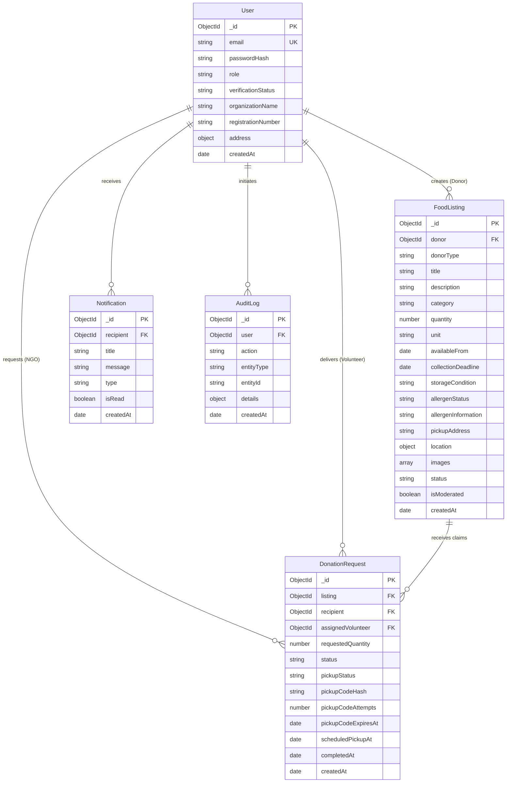

# FoodBridge — Database Schema & Data Models

FoodBridge uses **MongoDB** with **Mongoose ODM**. Schemas are designed for strict referential integrity, geospatial querying, and ACID transaction support.

---

## 1. Entity-Relationship Overview

---

## 2. Collections & Field Details

### `users`
- `role`: Enum (`household_donor`, `organization_donor`, `ngo`, `volunteer`, `admin`)
- `verificationStatus`: Enum (`pending`, `approved`, `rejected`, `not_required`)
- `accountStatus`: Enum (`active`, `suspended`, `deactivated`)
- **Indexes:**
  - `email` (Unique)
  - `role`
  - `verificationStatus`

### `foodlistings`
- `category`: Enum (`cooked_meals`, `bakery`, `packaged_food`, `fruits_vegetables`, `canned_goods`, `dry_groceries`, `other`)
- `unit`: Enum (`meals`, `kilograms`, `boxes`, `packages`, `items`, `grams`)
- `status`: Enum (`available`, `reserved`, `collected`, `expired`, `withdrawn`)
- `storageCondition`: Enum (`ambient`, `refrigerated`, `frozen`)
- `allergenStatus`: Enum (`none`, `contains`, `free_from`, `unknown`)
- `location`: GeoJSON Point `{ type: "Point", coordinates: [longitude, latitude] }`
- **Indexes:**
  - `donor`
  - `status`
  - `collectionDeadline`
  - `category`
  - `location` (2dsphere geospatial)

### `donationrequests`
- `status`: Enum (`pending`, `accepted`, `rejected`, `cancelled`, `completed`, `disputed`)
- `pickupStatus`: Enum (`awaiting_pickup`, `pickup_in_progress`, `collected`, `disputed`)
- `requestedQuantity`: Number (must be positive, cannot exceed listing quantity)
- `pickupCodeAttempts`: Max 5 failed attempts before lockout
- **Indexes:**
  - `listing`
  - `recipient`
  - `assignedVolunteer`
  - `status`
  - Compound unique index: `{ listing: 1, recipient: 1 }` for active claims
- **Indexes:**
  - `donor`
  - `status`
  - `category`
  - `expiryDate`
  - `pickupLocation.coordinates` (`2dsphere` geospatial index)
  - Compound text index on `title` and `description`

### `donationrequests`
- `status`: Enum (`pending`, `accepted`, `rejected`, `cancelled`)
- `pickupStatus`: Enum (`not_scheduled`, `scheduled`, `in_progress`, `completed`, `failed`, `disputed`)
- `pickupCode`: Stored as a one-way **bcrypt hash**. The plaintext code is never stored in the database.
- `pickupAttempts`: Counter with maximum 5 attempts to protect against brute-force verification attacks.
- **Indexes:**
  - Compound partial unique index on `{ listing: 1, requester: 1 }` where `status: 'pending'` to prevent duplicate active requests from the same NGO.
  - `listing`
  - `requester`
  - `volunteer`
  - `status`
  - `pickupStatus`

### `notifications`
- In-app notification alerts for donors (new claims), NGOs (decisions), and couriers (dispatches).
- **Indexes:**
  - `recipient`
  - `isRead`
  - `createdAt`

### `auditlogs`
- Tamper-evident logging for compliance, policy decisions, and account suspensions.
- **Indexes:**
  - `user`
  - `action`
  - `entityType`
  - `createdAt`
